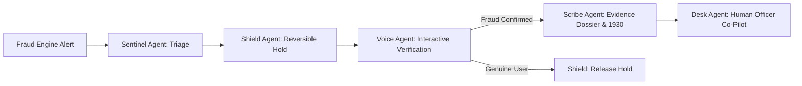

# 🛡️ Golden Hour Guardian

> **Autonomous AI Teammate for Payment Fraud Defense**  
> Built for the **Paytm Build for India AI Hackathon (Track 3: Autonomous AI Teammates)**.  
> *Interception, containment, and victim reporting in the critical first 60 minutes — with human-in-the-loop oversight on all financial decisions.*

[](https://github.com/DeshDeepakKant/golden-hour-guardian/actions)
[](https://vercel.com/new/clone?repository-url=https%3A%2F%2Fgithub.com%2FDeshDeepakKant%2Fgolden-hour-guardian)
[](https://www.python.org/downloads/)
[](https://fastapi.tiangolo.com)
[](tests/)
[](LICENSE)

---

## 📌 Executive Summary

India lost over **₹1,087 crore to UPI fraud** in FY24 alone. While mule networks drain accounts within **6 to 15 minutes**, the average victim takes over **4 to 6 hours** to understand what happened, reach support, and report on the 1930 National Cyber Crime Reporting Portal (NCRP).

**Golden Hour Guardian** bridges this critical gap. Acting as an autonomous AI teammate alongside bank fraud officers, it transforms reactive support into proactive sub-second containment:

1. **Sub-second Triage (<300ms):** Ingests fraud engine alerts (Paytm Pi), recalculates risk across 8 ledger signals, and selects trusted contact channels (detecting SIM swaps).
2. **Autonomous Reversible Containment:** Instantly places a reversible 60-minute hold on the victim's *own* outgoing UPI payments and revokes rogue sessions on attacker devices.
3. **Zero-Secret Spoken & App Verification:** Initiates bilingual (English/Hindi) interactive check on trusted devices without ever asking for OTP, PIN, password, or CVV.
4. **Automated Evidence Dossier & 1930 Scribe:** Generates court-ready evidence packs and pre-populates copy-pasteable NCRP complaint forms for the victim.
5. **Human-in-the-Loop Governance:** Strict 3-Tier policy rails ensure liability, partner bank disputes, and fund credits are reserved strictly for human officers.
6. **Cryptographic Integrity:** Tamper-evident, hash-chained SHA-256 audit log for complete legal defensibility.

---

## 🗺️ System Architecture & Workflow



👉 **View the complete, interactive system workflow:** [`WORKFLOW.md`](WORKFLOW.md) or [`docs/workflow.html`](docs/workflow.html).

---

## 🚀 Live Demo & Interfaces

- **Unified Portal:** [Landing Hub](web/index.html)
- **Fraud Operations Desk:** `/officer/` — Live real-time SSE stream, queue triage, and cryptographic audit inspector.
- **Victim Mobile Simulator:** `/victim/` — Interactive PWA dialogue with simulated voice & button responses.
- **Pitch Deck Presentation:** [`Golden_Hour_Guardian_Pitch_Deck.pptx`](Golden_Hour_Guardian_Pitch_Deck.pptx)

---

## ⚙️ Quickstart (Run Locally)

### Prerequisites
- Python 3.12+
- `git`

### 1. Clone & Set Up Virtual Environment

```bash
git clone https://github.com/DeshDeepakKant/golden-hour-guardian.git
cd golden-hour-guardian

python3 -m venv .venv
source .venv/bin/activate
pip install -r requirements.txt
```

### 2. Configure Environment (Optional)

```bash
cp .env.example .env
# Edit .env to add your ANTHROPIC_API_KEY (optional: falls back to deterministic templates if omitted)
```

### 3. Run Test Suite (269 Tests)

```bash
pytest -v
```

### 4. Start the Application

```bash
uvicorn app.main:app --host 0.0.0.0 --port 8000 --reload
```

Visit:
- Landing Portal: `http://localhost:8000/`
- Officer Console: `http://localhost:8000/officer`
- Victim Mobile App: `http://localhost:8000/victim`

---

## 🐳 Docker Deployment

Run with a single command:

```bash
docker build -t golden-hour-guardian .
docker run -p 8000:8000 golden-hour-guardian
```

---

## ☁️ Cloud Deployments

### 1. Frontend on Vercel
The frontend is completely decoupled in the `web/` directory and pre-configured with `vercel.json`:
1. Push this repository to your GitHub account.
2. Go to [vercel.com](https://vercel.com) and click **"Add New Project"**.
3. Select this repository and click **Deploy**.
4. Use the landing page API configuration bar to connect your live backend URL!

### 2. Free Backend Hosting Options
Deploy the Python FastAPI backend for free using:
- **Render (Recommended):** Uses included [`render.yaml`](render.yaml) blueprint. Free Python web service with automatic HTTPS.
- **Railway:** Connect GitHub repository, 1-click Python deployment with $5 free trial credit.
- **Fly.io:** Deploy with `fly launch` using the included [`Dockerfile`](Dockerfile) (Free allowances).
- **Koyeb:** Deploy Docker container or git repo with free nano instance.
- **Hugging Face Spaces:** Free Docker/FastAPI space with persistent uptime.

---

## 🔒 Security & Compliance Architecture

| Principle | Implementation |
| :--- | :--- |
| **Strict 3-Tier Policy** | Tier 1 (autonomous reversible holds), Tier 2 (mandatory officer approval for bank disputes/credits), Tier 3 (strictly forbidden: never freezes third-party accounts, never files police complaints on victim's behalf). |
| **Zero-Secret Guarantee** | Hardcoded regex interceptors block any prompt or LLM output requesting OTP, PIN, password, or CVV. |
| **DPDP Compliance** | Automatic masking of 10+ digit PAN/Aadhaar/Account numbers (`redact_digits`). |
| **Audit Immutability** | Cryptographic SHA-256 hash chaining on all case transitions (`prev_hash` validation). |

---

## 📄 License

This project is licensed under the MIT License — see the [LICENSE](LICENSE) file for details.
