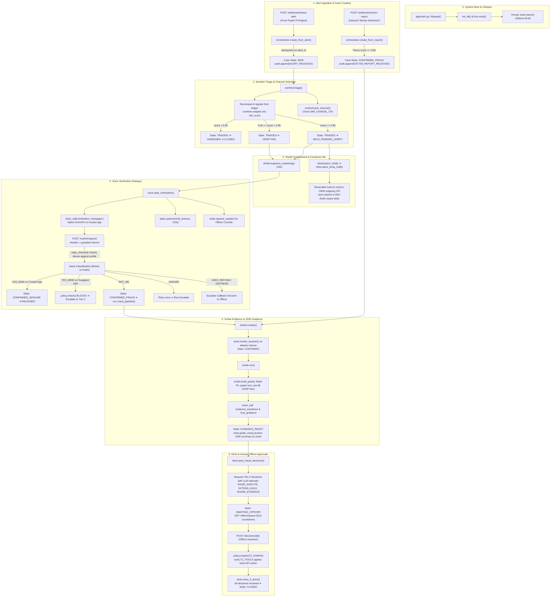

# Golden Hour Guardian — Application Workflow

This document details the complete end-to-end execution workflow of **Golden Hour Guardian**, traced directly from the codebase.

---

## Workflow Diagram

---

## Available Formats

| Format | Path | Best For |
|---|---|---|
| **Mermaid Source (.mmd)** | [`docs/workflow.mmd`](file:///home/anya/Videos/golden-hour-guardian/docs/workflow.mmd) | Version control, diagrams-as-code, and CLI tools |
| **Vector Graphics (.svg)** | [`docs/workflow.svg`](file:///home/anya/Videos/golden-hour-guardian/docs/workflow.svg) | High-resolution scalable viewing, slide embeds, and print |
| **Raster Image (.png)** | [`docs/workflow.png`](file:///home/anya/Videos/golden-hour-guardian/docs/workflow.png) | Presentations, reports, and quick image previews |
| **Standalone Web (.html)** | [`docs/workflow.html`](file:///home/anya/Videos/golden-hour-guardian/docs/workflow.html) | Interactive browser viewer with zoom & pan |

---

## Codebase Reference Map

1. **Subsystem 0: Lifecycle**
   - Startup: [`app/main.py::lifespan()`](file:///home/anya/Videos/golden-hour-guardian/app/main.py#L21-L31)
   - DB Init: [`app/db.py::init_db()`](file:///home/anya/Videos/golden-hour-guardian/app/db.py#L14)
   - Model Warmup: [`app/brain/api.py::Brain.warm()`](file:///home/anya/Videos/golden-hour-guardian/app/brain/api.py#L55-L60)

2. **Subsystem 1: Ingestion**
   - Alert Webhook: [`app/routes/webhooks.py::fraud_alert()`](file:///home/anya/Videos/golden-hour-guardian/app/routes/webhooks.py#L11-L19)
   - Victim Report: [`app/routes/webhooks.py::victim_report()`](file:///home/anya/Videos/golden-hour-guardian/app/routes/webhooks.py#L22-L29)
   - Case Factory: [`app/orchestrator.py::create_from_alert()`](file:///home/anya/Videos/golden-hour-guardian/app/orchestrator.py#L24-L42) & [`create_from_report()`](file:///home/anya/Videos/golden-hour-guardian/app/orchestrator.py#L44-L68)

3. **Subsystem 2: Triage**
   - Signal Recomputation: [`app/agents/sentinel.py::compute_signals()`](file:///home/anya/Videos/golden-hour-guardian/app/agents/sentinel.py#L44-L108)
   - Path Triage: [`app/agents/sentinel.py::triage()`](file:///home/anya/Videos/golden-hour-guardian/app/agents/sentinel.py#L132-L147)
   - Channel Selection: [`app/agents/sentinel.py::pick_channel()`](file:///home/anya/Videos/golden-hour-guardian/app/agents/sentinel.py#L111-L116)

4. **Subsystem 3: Containment**
   - Outgoing Hold: [`app/agents/shield.py::place_hold()`](file:///home/anya/Videos/golden-hour-guardian/app/agents/shield.py#L20-L24)
   - Auto-Expiry Timer: [`app/agents/shield.py::_hold_expiry()`](file:///home/anya/Videos/golden-hour-guardian/app/agents/shield.py#L72-L97)
   - Marketing Hold: [`app/agents/shield.py::suppress_marketing()`](file:///home/anya/Videos/golden-hour-guardian/app/agents/shield.py#L38-L41)

5. **Subsystem 4: Verification**
   - Outreach: [`app/agents/voice.py::start_verification()`](file:///home/anya/Videos/golden-hour-guardian/app/agents/voice.py#L72-L83)
   - Response Handler: [`app/agents/voice.py::handle_response()`](file:///home/anya/Videos/golden-hour-guardian/app/agents/voice.py#L133-L202)
   - Hardware Authentication: [`app/agents/voice.py::reply_channel()`](file:///home/anya/Videos/golden-hour-guardian/app/agents/voice.py#L121-L131)

6. **Subsystem 5: Evidence & Guidance**
   - Containment & Device Revoke: [`app/agents/shield.py::contain()`](file:///home/anya/Videos/golden-hour-guardian/app/agents/shield.py#L43-L59)
   - Pack Construction: [`app/agents/scribe.py::build_pack()`](file:///home/anya/Videos/golden-hour-guardian/app/agents/scribe.py#L32-L60)
   - 1930 Guidance: [`app/agents/scribe.py::run()`](file:///home/anya/Videos/golden-hour-guardian/app/agents/scribe.py#L62-L85)

7. **Subsystem 6: Officer Approvals & Closure**
   - Pending Decisions: [`app/agents/desk.py::open_fraud_decisions()`](file:///home/anya/Videos/golden-hour-guardian/app/agents/desk.py#L32-L37)
   - Queue: [`app/routes/cases.py::officer_queue()`](file:///home/anya/Videos/golden-hour-guardian/app/routes/cases.py#L37-L55)
   - Decision Execution: [`app/agents/desk.py::apply()`](file:///home/anya/Videos/golden-hour-guardian/app/agents/desk.py#L48-L90)
   - Auto-Closure: [`app/agents/desk.py::close_if_done()`](file:///home/anya/Videos/golden-hour-guardian/app/agents/desk.py#L92-L99)
